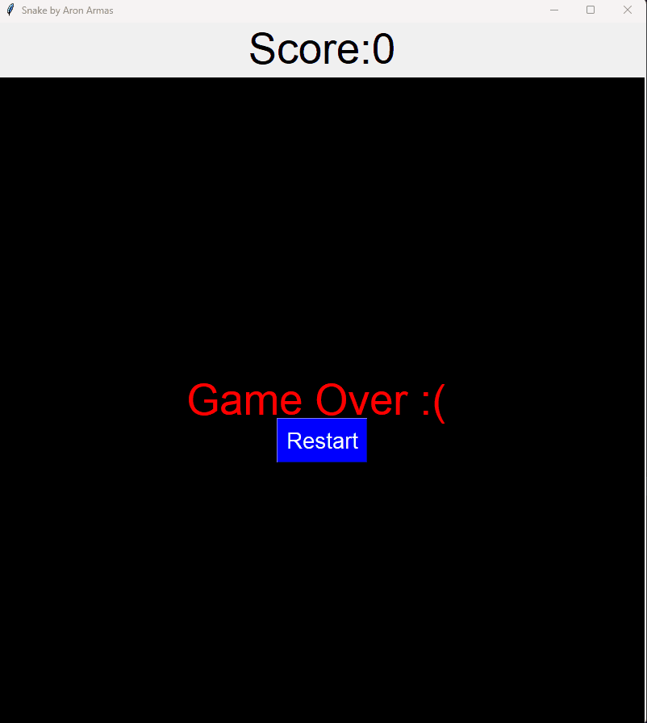

# Snake

A classic Snake game built with Python and Tkinter.

## Note
This is a desktop GUI app (not a web app), there's no live demo link. Clone and run locally to play.

## Controls
Arrow keys to move.

## Language 
- Python
- Tkinter (built into Python's standard library, no install needed)

## Running locally
1. Clone the repo
2. Make sure you have Python 3 installed
3. Run: `python snake.py`
